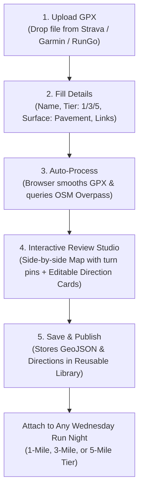

# Run Creation, Turn-by-Turn Directions & Route Resources — Architecture Plan

> **Update (Nov 9, 2026):** The port is done. `src/utils/routeEngine/` is the source of truth, and the original Python prototype in `scripts/` has been removed (it's still in git history).
>
> **Document Version:** 1.0  
> **Status (Nov 10, 2026):** Phases 1–4 are implemented (engine, Route Studio, run-card/check-in integration, route library with edit versions and delete). Not built: print view, "report a problem", mile markers, first/last-200 m privacy trim. Section 9 questions are historical.  
> **Created:** November 7, 2026  
> **Original context (historical):** this plan ported the former Python prototype and route-resource notes into the app. `scripts/gpx_route/` is no longer present; use `src/utils/routeEngine/` as the current implementation. Original proposed tiers/surfaces in the design below are not scheduling validation rules: current runs use measured saved route choices and the supported source types.

---

## 1. Executive Summary & Goals

The goal is to enable **Run Organizers and Admins** to easily create and manage reusable club routes directly within the app:
1. **Source Agnostic:** An organizer creates a course in Strava, Garmin Connect, RunGo, or gpx.studio, and downloads the `.gpx` file.
2. **In-App Creation Studio:** The organizer uploads the `.gpx` file to a dedicated route creation interface in the app and specifies:
   - **Route Name** (e.g., *"The Road to El Dorado"*, *"Heritage Park 3-Miler"*)
   - **Target Round Distance Tier:** `1`, `3`, or `5` miles (with auto-computed measured GPS miles, e.g. `1.22 mi`, `3.15 mi`)
   - **Surface Type:** `Pavement` (default), `Trail`, `Gravel`, or `Mixed`
   - **Additional Route Notes / Hazards:** (e.g., *"Use crosswalk on Main St; unlit path on north loop"*)
   - **External Resource Links:** Direct URLs for Strava, Garmin Connect, RunGo, etc.
3. **Automated Turn-by-Turn Engine (100% Free & In-Browser):**
   - The app processes the GPX track, smooths GPS jitter, simplifies the geometry, queries OpenStreetMap's free Overpass API once, and matches points to street names and landmarks (e.g., *"Start on Dead Cat Alley by Blue Note Brewing"*).
   - Generates standardized **GeoJSON** with line geometry and numbered turn pins.
   - Generates dual turn-by-turn directions:
     - 📱 **Concise Mode** for phone cue sheets while running (`START [E] Dead Cat Alley`, `L on 3rd St`, `R on Main St`).
     - 📖 **Verbose Narrative Mode** for detailed pre-run study (`Turn left onto 3rd Street, heading north`).
4. **Organizer Review & Edit:** The organizer reviews the generated map and turn steps, tweaks any turn instructions if needed, and clicks **Publish & Save for Reuse**.
5. **Fast, Lightweight Member Experience:** Check-in reads precomputed GeoJSON and directions in milliseconds with zero Overpass API dependencies on run nights.

---

## Current implementation versus the original design

The remaining model diagrams, type examples and UX proposals are the original architecture sketch, not a schema to copy into production. The current types are in `src/types/index.ts`; implementation is `src/utils/routeEngine/`, `RouteStudioModal.tsx`, `src/utils/runChoices.ts` and the Firestore serialization helpers. In particular:

- Run choices reference saved route IDs and measured mileage with optional run-specific loop limits; fixed 1/3/5 tiers are not required.
- Do not embed full direction arrays or GeoJSON inside each meetup choice. Full route geometry is loaded on demand; stored nested structures are serialized as required by Firestore.
- Raw GPX is not retained as the source of truth; downloads are rebuilt from saved points. Original optional `slug`, draft/archive and creator fields below are proposals, not guaranteed persisted fields.
- Route processing is isolated in workers with cancellation/timeouts and session OSM caching; network time is not guaranteed to be 2–4 seconds.
- The browser engine does not require a Python backend. This does not mean every other app feature is Spark-only or cost-free: the calendar uses a Cloud Function.

See [route-import.md](route-import.md), [performance-loading.md](performance-loading.md), [osm-caching.md](osm-caching.md) and [documentation-status.md](documentation-status.md) for implemented behavior and remaining checks.

## 2. Integration with Existing Architecture

| Layer | Current State | Proposed Enhancement |
| :--- | :--- | :--- |
| **Data Storage** | `GPXRoute` stores raw points (`{lat, lon, ele}`); `MeetupEvent.routes` stores basic `RouteOption`. | Enhance `GPXRoute` and `RouteOption` to store full GeoJSON, turn-by-turn steps, concise cues, external links (`stravaUrl`, `garminUrl`, `rungoUrl`), and target tier (`1 \| 3 \| 5`). |
| **Routing Computation** | Standalone Python script (`scripts/gpx_directions.py` + `scripts/gpx_route/`). | Port the pure Python geometry and Overpass logic into a browser-side TypeScript module (`src/utils/routeEngine/`). Runs 100% client-side with zero server cost and zero backend dependencies. |
| **Map Rendering** | `MapViewer.tsx` uses Leaflet + OpenStreetMap to draw a simple polyline. | Enhance `MapViewer.tsx` to render the saved GeoJSON, numbered turn pins, start/finish markers, and interactive step-to-pin highlighting. |
| **Event Scheduling** | `NewRunModal.tsx` and `AdminDashboard.tsx` pick from existing routes or create dates. | Seamless route selection where choosing a route automatically populates distance, surface, external links, and turn-by-turn directions. |

---

## 3. Data Model Specification

### 3.1 Enhanced `GPXRoute` (Reusable Route Library)
```typescript
export interface RouteTurnStep {
  step: number;               // 1, 2, 3...
  cue: string;                // "START", "L", "R", "BR", "BL", "U", "END"
  instruction: string;        // "Turn left onto 3rd Street, heading north"
  instructionConcise: string; // "L on 3rd St"
  street: string;             // "3rd Street"
  streetConcise: string;      // "3rd St"
  distanceMeters: number;     // 725
  distanceDisplay: string;    // "0.45 mi" or "164 ft"
  headingCardinal?: string;   // "N", "E", "S", "W", "NE", etc.
  turnDegrees?: number | null;// -65
  atKm: number;               // Cumulative distance at turn
  point: [number, number];    // [lon, lat] for turn pin
  crossStreets?: string[];    // ["Court St", "Cross St"]
}

export interface RouteExternalLinks {
  stravaUrl?: string;         // e.g. "https://www.strava.com/routes/..."
  garminUrl?: string;         // e.g. "https://connect.garmin.com/modern/course/..."
  rungoUrl?: string;          // e.g. "https://routes.rungoapp.com/route/..."
  gpxDownloadUrl?: string;    // Direct GPX download
}

export interface GPXRoute {
  id: string;
  name: string;               // e.g. "The Road to El Dorado"
  slug: string;               // "the-road-to-el-dorado"
  description: string;        // Notes, hazards, parking, meet info
  targetDistanceTier: '1' | '3' | '5'; // Round club distance tier
  distanceMiles: number;      // Exact measured distance (e.g. 1.22)
  elevationGainFt: number;    // Measured elevation gain
  surface: SurfaceType;       // "Pavement" (default), "Trail", "Mixed"
  difficulty: DifficultyType; // "Easy", "Moderate", "Challenging"
  startLocationName?: string; // "Dead Cat Alley behind Blue Note Brewing"
  startCoordinates?: [number, number]; // [lat, lon]
  
  // Directions & GeoJSON
  directions: RouteTurnStep[];// Turn-by-turn steps
  geoJson: GeoJSON.FeatureCollection; // Full LineString + Turn Points
  externalLinks: RouteExternalLinks;
  
  // Storage & Metadata
  gpxXml?: string;            // Original GPX source for redownloading
  createdBy?: string;         // Organizer name or email
  createdAt: string;          // ISO date
  updatedAt?: string;
  isArchived?: boolean;       // Soft delete
}
```

### 3.2 Enhanced `MeetupEvent` & `RouteOption`
```typescript
export interface RouteOption {
  routeId: string;            // Reference to GPXRoute in library
  name: string;               // "The 123 Loop"
  targetTier: '1' | '3' | '5';
  actualMiles: number;        // 1.22
  surface: SurfaceType;       // Pavement
  notes?: string;
  externalLinks?: RouteExternalLinks;
  directions?: RouteTurnStep[]; // Embedded for instant offline mobile access
  geoJson?: GeoJSON.FeatureCollection;
}
```

---

## 4. In-Browser Turn-by-Turn Engine (`src/utils/routeEngine/`)

The Python engine in `scripts/gpx_route/` is clean, lightweight, and uses standard math. We can port it directly into TypeScript for client-side execution in the browser:

```
src/utils/routeEngine/
├── index.ts              # Main entry: buildDirectionsFromGpx(gpxText, options)
├── geometry.ts           # Equirectangular projection, Haversine, smoothing, Douglas-Peucker simplification
├── overpass.ts           # Public OSM Overpass API client with 3 fallback mirrors & timeout
├── streetIndex.ts        # Spatial index for candidate streets & heading matching
├── turnClassifier.ts     # Turn angle calculation (left, right, bear, u-turn) & leg collapsing
└── formatters.ts         # Concise cue sheet builder, street abbreviations, landmark replacement
```

### Why In-Browser Execution is Ideal:
1. **Zero Server Costs:** Runs completely inside the browser during upload. No backend containers, no Python microservice to host, and fits 100% on Firebase's free Spark tier.
2. **Public Overpass API:** Free public Overpass endpoints (`overpass-api.de`, `kumi.systems`, `private.coffee`) support CORS `fetch` requests directly from the browser.
3. **One-Time Computation:** The query only runs **once** when an organizer creates or edits a route. Check-in on Wednesday night never touches Overpass or does any heavy math—it just reads the saved JSON.
4. **Instant Offline Caching:** The resulting directions and GeoJSON are saved in Firestore and cached locally in IndexedDB / LocalStorage by the PWA.

---

## 5. Organizer Route Creation Workflow (UX Walkthrough)



### Step 1: GPX File Upload
- Drag-and-drop `.gpx` file exported from Strava, Garmin Connect, RunGo, or Apple Watch.
- Instant validation: checks for valid XML, at least 2 track points, and displays route bounds.

### Step 2: Route Metadata Form
- **Route Name:** Input field (prefilled from GPX `<name>` or filename).
- **Target Distance Tier:** Radio / Pill buttons:
  - `[ 1 Mile Route ]`
  - `[ 3 Mile Route ]` *(Default)*
  - `[ 5 Mile Route ]`
- **Surface:** Pill selector:
  - `[ Pavement (Default) ]` | `[ Trail ]` | `[ Mixed ]` | `[ Gravel ]`
- **Notes & Hazards:** Text area for organizer instructions (e.g., *"Meet at Blue Note patio; cross at 3rd & Main traffic signal"*).
- **External Resource Links:**
  - `Strava Route URL` (optional)
  - `Garmin Connect Course URL` (optional)
  - `RunGo Route URL` (optional)

### Step 3: Automated Processing Status
- Displays a clean progress indicator:
  - *"Cleaning GPS track..."* ➔ *"Matching street network via OpenStreetMap..."* ➔ *"Building turn cue sheet..."* (takes 2–4 seconds).

### Step 4: Interactive Review Studio
- **Left Column (or Top on Mobile): Interactive Leaflet Map**
  - Route polyline in Woodchuckers `#1A607C` Teal.
  - Numbered circular turn pins (1, 2, 3...) corresponding to each step.
  - Start pin at Blue Note Brewing with green marker; finish checkered flag.
- **Right Column (or Bottom on Mobile): Editable Cue Sheet**
  - Toggle between **Concise** (`L on 3rd St`) and **Verbose** (`Turn left onto 3rd Street, heading north`).
  - Each step is an editable card:
    - Change turn cue (`Turn Left`, `Bear Right`, `Continue Straight`).
    - Edit street name or add local landmark notes (e.g. *"Look for the green water tower"*).
    - Tapping any card pans and zooms the map to that turn pin!

### Step 5: Save & Reuse
- Organizers click **"Save Route to Club Library"**.
- The route is now permanently available for any future Wednesday run.

---

## 6. Runner / Member Check-In & Run Details Experience

On run nights (and ahead of time in the schedule view), members see the complete route experience directly on their phones:

### 1. Distance Tier Tabs
When Wednesday has multiple options (e.g. 1-Mile Walk, 3-Mile Loop, 5-Mile Run), members tap the distance tab to toggle the route and map instantly.

### 2. Interactive Route Map
- Full mobile-responsive Leaflet map with OpenStreetMap tiles (no Google Maps API billing or keys required).
- Numbered turn pins matching the cue sheet.
- **"Show My Location" Blue Dot:** Uses browser Geolocation API (`navigator.geolocation.watchPosition`) so runners can see where they are relative to the route line.
- Tapping a turn pin highlights the corresponding direction card.

### 3. Dual Directions View
Runners can switch between two reading formats via a segmented control:
- 📱 **Concise Cue Sheet (Running Mode):**
  ```
  1. START [E] Dead Cat Alley (Blue Note Brewing) — 164 ft
  2. L on 3rd St — 0.45 mi
  3. R on Court St — 0.22 mi
  4. R on 4th St — 0.40 mi
  5. END at Blue Note Brewing
  ```
- 📖 **Verbose Narrative (Pre-Run Mode):**
  ```
  1. Start on Dead Cat Alley by Blue Note Brewing, heading east for 164 ft.
  2. Turn left onto 3rd Street, heading north for 0.45 miles.
  3. Turn right onto Court Street, heading east for 0.22 miles.
  ...
  ```

### 4. External Resource Action Bar
Clear, touch-friendly buttons with recognizable branding:
- `[ 🟠 Open in Strava ]` (opens Strava app or web)
- `[ 🔵 Send to Garmin ]` (opens Garmin Connect course)
- `[ 🟢 RunGo Voice Nav ]` (launches turn-by-turn voice directions in RunGo)
- `[ 📥 Download GPX ]` (downloads `.gpx` file to phone for Apple Watch / Coros / Suunto)
- `[ 📍 Directions to Start ]` (deep links into Apple Maps / Google Maps for driving/walking to Blue Note)

---

## 7. Zero-Cost & Free Resources Strategy

To preserve the club's 100% free operation on the Firebase Spark tier:
1. **Map Tiles:** Standard OpenStreetMap tiles (`tile.openstreetmap.org`) are free under ODbL with proper attribution (`© OpenStreetMap contributors`).
2. **Routing / Street Data:** Public Overpass API mirrors (`overpass-api.de`, `kumi.systems`) queried **only once at route creation time**, never during run nights.
3. **Turn Generation Math:** 100% in-browser TypeScript math (no serverless execution quotas or third-party paid APIs like Google Directions or Mapbox Directions).
4. **External Services:** Links point to free user routes in Strava, Garmin Connect, and RunGo without requiring paid enterprise API partnerships.

---

## 8. Implementation Phases

```
┌────────────────────────────────────────────────────────────────────────┐
│ Phase 1: Core Engine Port (TypeScript)                                  │
│ • Port geometry, OSM Overpass fetch, street index, and turn logic     │
│ • Unit tests against the sample 1.22 mi El Dorado GPX                  │
├────────────────────────────────────────────────────────────────────────┤
│ Phase 2: Route Creation & Review Studio Modal                          │
│ • Upload GPX file + metadata (Name, Tier 1/3/5, Surface, Notes, Links) │
│ • Review screen with interactive Leaflet map + editable turn cards     │
│ • Save to GPXRoute library & Firestore                                 │
├────────────────────────────────────────────────────────────────────────┤
│ Phase 3: Run Card & Check-In Integration                               │
│ • Distance tabs (1, 3, 5 mi) on Run Cards & Check-In screen            │
│ • Turn-by-turn display with Concise / Verbose toggle                  │
│ • External link buttons (Strava, Garmin, RunGo, Download GPX)          │
│ • "Show my location" GPS tracking dot                                  │
├────────────────────────────────────────────────────────────────────────┤
│ Phase 4: Route Library Management & Reuse                              │
│ • Route Library catalog in Admin Portal: browse, edit, duplicate       │
│ • 1-click attach saved route to upcoming Wednesday events              │
└────────────────────────────────────────────────────────────────────────┘
```

---

## 9. Original discussion questions — historical

1. **Default Meeting Landmark:** Should all routes default to landmarking `"Dead Cat Alley by Blue Note Brewing"` for the start/finish? (Already configured in `gpx_directions.py` defaults).
2. **Distance Tiers:** Are `1`, `3`, and `5` miles the sole standard tiers, or should custom tiers (e.g. `10K`, `Half`) be supported in the dropdown?
3. **Turn Step Editing:** Do you want organizers to be able to manually add custom hazard warnings directly into a turn card (e.g. *"Watch for dogs on lawn"* or *"Construction on sidewalk"*), or keep notes in the main notes field?
