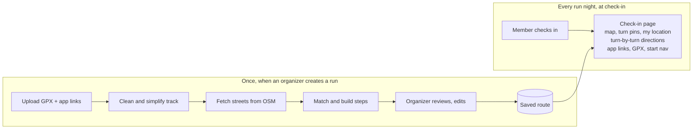

# Run Club Route Resources — Implementation Plan

_As of 2026-11-07. Status 2026-11-10: rollout phases 1–3 are built in the app (see [route-creation-architecture-plan.md](route-creation-architecture-plan.md)). Still open from phase 4: Print option, "report a problem", mile markers, and the first/last 200 m privacy trim. The open questions at the end are still unanswered._

## Overview

Organizers create a run once from a GPX file. Members who check in on run night get a map, plain-text turn-by-turn directions and links to the club's usual running apps. No member needs a special watch, app or login to follow the route.

**Who uses it**

- **Organizers** create runs: upload a GPX, name the run, paste Garmin, RunGo and Strava links, review the auto-generated directions and publish.
- **Members** check in on run night and see everything for that night's run on their phone.

**What members get at check-in**

- An interactive map of the route with start, finish, turns and mile markers, plus their own location.
- Numbered turn-by-turn directions with street names and landmarks, e.g. "Start in Dead Cat Alley behind Blue Note Brewing; turn right on 3rd Street."
- Buttons for Garmin, Strava and RunGo, a GPX download, and "Directions to start" in Google or Apple Maps.

The core pieces are already proven: a working GPX-to-directions script (`gpx_directions.py`) and a tested sample route, The Road to El Dorado (1.27 mi loop, downtown Woodland).

## Features

### Create Run (organizers)

1. **Upload GPX.** Accept course files from Garmin Connect, Strava, RunGo or gpx.studio. Reject files with fewer than two points or larger than 5 MB.
2. **Enter details.** Run name, run night date, optional notes (meeting spot, pace groups, water stops).
3. **Add app links.** Garmin Connect course URL, Strava route URL, RunGo route URL. Each is optional; check that each link points at the right site.
4. **Generate.** The system computes distance, elevation gain, start landmark and turn-by-turn directions, and shows a map preview.
5. **Review and edit.** Organizers fix any wrong street or turn word and add local notes ("use the crosswalk at Main").
6. **Publish.** The run appears on the chosen run night. Runs can be saved as drafts, copied and reused on later nights.

### Check-in view (members)

- **Header:** run name, distance, elevation gain, start location.
- **Map:** full-width on phones, route line, start/finish, numbered turn pins, mile markers, a "Show my location" button.
- **Directions:** numbered steps, large type; tapping a step zooms the map to that turn.
- **Resources:** buttons for Garmin, Strava and RunGo (each labeled "needs account"), Download GPX, Directions to start.
- **Print:** a clean one-page printout of map and directions.
- **Several routes per night:** tabs or cards when a night has more than one distance.

## Architecture

All heavy work happens once, when an organizer creates a run; check-in only reads saved results. That keeps the check-in page fast on a phone in a parking lot and never depends on OpenStreetMap's servers being up or within rate limits on run night.

Organizer review sits between the automatic steps and the saved route, so members only ever see checked directions.

**Platform options** — the choice depends on what the club site is built on:

| Site built on | Where directions are generated | What has to be built |
| --- | --- | --- |
| Custom site (Python, Node, PHP) | On the server at upload, using `gpx_directions.py` or a port of it | Upload endpoint, database tables, check-in page |
| WordPress | In the organizer's browser on the Create page (JavaScript port) | A small plugin: custom post type "Run", admin page, shortcode for the check-in view |
| Squarespace, Wix or similar | In the organizer's browser on a standalone Create page | Results saved as JSON and embedded in a code block on the check-in page |

The browser-side JavaScript version works on any host and needs no server code, so it is the safest default until the platform is confirmed.

## Data model

A Run Night holds one or more Routes; each Route stores its file, its generated results and its links, so a route can be reused on any night.

| Record | Field | Type | Notes |
| --- | --- | --- | --- |
| Run Night | id, date, title, notes | date, text | e.g. "Thursday social run" |
| Run Night | routes | list of Route ids | 1–3 typical (e.g. 3 mi and 5 mi) |
| Route | id, name, slug | text | "The Road to El Dorado" |
| Route | gpx_file | file | Original upload, offered as Download GPX |
| Route | track | GeoJSON | Smoothed, simplified line for the map |
| Route | distance_m, elevation_gain_m | number | Shown in miles and feet |
| Route | start_lat, start_lon, start_label | number, text | "Dead Cat Alley behind Blue Note Brewing" |
| Route | directions | JSON list | step, instruction, street, distance_m, turn, lat, lon; editable |
| Route | links | object | garmin_url, strava_url, rungo_url (each optional) |
| Route | status, created_by, updated_at | text, user, time | draft or published |
| Check-in | member, run_night, route, time | ids, time | Existing check-in system; add route choice |

Each direction step stores the turn's coordinates so the map can place a numbered pin and zoom to it when tapped.

## Directions engine

The engine turns a GPX line into street-by-street steps using free OpenStreetMap data; it already works on the sample route and needs a port plus a review step, not new research.

1. **Read and clean the GPX.** Parse track or route points, drop duplicates, smooth GPS jitter (about 12 m window) and simplify the line.
2. **Fetch streets once.** One Overpass API query for every street, path and named place in the route's bounding box plus about 200 m.
3. **Match to streets.** Every 5 m, pick the nearest street running the same direction; a short majority vote removes stray matches at intersections.
4. **Build steps.** Group matches into legs per street; label each change as continue, bear, turn, sharp turn or U-turn with left/right, distance and heading.
5. **Add landmarks.** Name the start after the nearest business or place within 60 m; optionally list cross streets on each leg.
6. **Organizer review.** Show the steps as editable rows beside the map preview; save the edited version as the one members see.

**Known limits:** unnamed paths show as "unnamed path" or "alley"; very noisy watch recordings can give a wrong turn word in the first few hundred feet. The review step covers both, and drawn courses (Garmin Connect, gpx.studio) come out clean.

## Map display

Use Leaflet with OpenStreetMap tiles: free, open source, no API key, and about 40 KB of JavaScript.

- **Route line** drawn from the saved GeoJSON in a bold club colour, with direction arrows every few hundred metres.
- **Markers:** green start, checkered finish (one combined marker for loops), numbered turn pins matching the direction steps, mile markers.
- **Show my location:** the browser's location permission, a blue dot that follows the runner, and a button to re-centre.
- **Linked to directions:** tapping a step flies the map to that turn and highlights it; tapping a pin highlights the step.
- **Phone first:** map about 60% of screen height, directions below, buttons large enough for cold fingers.
- **Attribution:** "© OpenStreetMap contributors" stays visible in the map corner.

Google My Maps is an alternative for organizers who prefer it, but it needs a separate embed per route and cannot link pins to the club's own directions list.

## Considerations

| Topic | Risk | What we do |
| --- | --- | --- |
| Privacy | A recorded watch GPX can start or end at someone's home | Warn on upload; offer to trim the first and last 200 m; prefer drawn courses |
| Data licence | OpenStreetMap data requires credit | "© OpenStreetMap contributors" on the map, directions and printout |
| Map tiles | OSM's free tiles are for light use | Fine at club traffic; switch to MapTiler or Stadia free tier if traffic grows |
| Overpass API | Shared public servers, rate limited | Called only at creation; cache results; fall back to a second mirror |
| App links | Garmin, Strava and RunGo need accounts and some need a compatible watch | Label each button; always offer GPX download and plain directions |
| Weak signal | Runners may lose data on the route | Page loads everything at check-in; Print option; map tiles cache as viewed |
| Accuracy | Auto directions can be wrong on paths and in parks | Organizer review before publish; members can report a problem |
| Safety | Night runs and road crossings | Optional notes field for lighting, crossings and hazards shown above directions |

## Rollout

Ship in four phases, each usable on its own, so members benefit from the first run night onward.

1. **Prototype.** One shareable page with both screens, using the El Dorado route. Committee clicks through it and agrees the look and steps. Gate: committee sign-off.
2. **Check-in view live.** Organizers build runs with the prototype's Create page and paste the saved result into the site. Members get map, directions and links. Gate: two run nights without problems.
3. **Create Run in the site.** Upload form, editable directions, drafts, copy a past route, several routes per night. Gate: two organizers create runs unaided.
4. **Extras.** Mile markers, Print, "report a problem", route library with search, elevation profile.

## Open questions

- [ ] What is the club website built on, and who maintains it?
- [ ] How does check-in work today (form, app, paper), and can it show a page afterwards?
- [ ] Should the route page be visible without checking in, e.g. for members planning ahead?
- [ ] How many routes per run night is typical?
- [ ] Who are the organizers allowed to create and publish runs?
- [ ] Club colour and logo for the map and printout.
